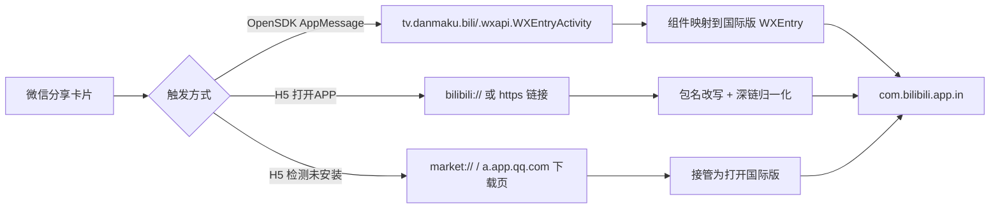

# 跳转国际版b站

> 让微信里的 B 站分享视频，直接交给 **国际版哔哩哔哩**（`com.bilibili.app.in`）打开。
>
> 一个基于 LSPosed / Xposed 的 Android 模块，覆盖「意图层 + 网页层」两级跳转链路。

---

## 它解决什么问题

微信里别人分享的 B 站视频，点「打开APP」时往往只能去国内版哔哩哔哩（`tv.danmaku.bili`），
即使手机里装的是国际版，也永远不会被唤起。实测排查后确认有三个独立原因：

| # | 现象 | 根因 |
|---|---|---|
| 1 | 提示「未找到相关应用，请确认是否已经卸载」 | 微信先检查国内版装没装，查不到就自己弹提示、**根本不发 Intent** |
| 2 | 弹「打开方式」，列出一堆同名 bilibili | 改写目标包后没指定具体页面，国际版内部**多个 Activity 都能匹配**同一链接 |
| 3 | 系统弹出「前往软件商店安装」（ColorOS） | B 站 H5 检测未安装后会跳商店下载链接；ColorOS 的 `com.oplus.metis` 还会按场景推荐 |

模块逐一处理：

- **安装检查**：让微信在查询阶段就认为「国内版已安装」，它才会继续走跳转；
- **目标改写**：把目标包/组件改写成国际版对应入口；
- **入口收敛**：视频页转 `bilibili://video/{BV}` 深链、其余情况固定唯一 Activity；
- **商店链接**：接管 `market://` / `a.app.qq.com` 的「去装国内版」跳转。

> 第 3 条中的 ColorOS 系统级推荐属于系统服务行为，模块作用域是应用进程，拦不到，需要在系统设置里关闭（见「已知限制」）。

---

## 技术树

```
跳转国际版b站
├── 注入层（LSPosed / Xposed）
│   └── XposedInit          按进程安装 hook，跳过 B 站自身进程
│
├── 意图层（Java）
│   ├── Instrumentation.execStartActivity          所有 startActivity 的汇聚点
│   ├── ContextWrapper / Activity.startActivity*   直接拿 Context/Activity 启动
│   ├── ContextImpl.startActivity*                 最底层实现，JNI 兜底
│   ├── ApplicationPackageManager
│   │   ├── resolveActivity / queryIntentActivities  查询阶段就返回国际版
│   │   └── getPackageInfo / getApplicationInfo      国内版「存在性」兜底
│   └── 组件映射
│       └── tv.danmaku.bili.wxapi.WXEntryActivity
│           → com.bilibili.app.in.wxapi.WXEntryActivity
│
├── 网页层（腾讯 XWeb）
│   ├── com.tencent.xweb.WebView.loadUrl
│   ├── com.tencent.mm.ui.widget.MMWebView.loadUrl
│   ├── android.webkit.WebView.loadUrl
│   └── WebViewClient.shouldOverrideUrlLoading
│
└── 归一化 / 兜底
    ├── https://…/video/{BV} → bilibili://video/{BV}
    ├── bilibili://comment/{BV} → https://www.bilibili.com/video/{BV}
    ├── 商店下载链接 → 打开国际版
    └── 唯一 Activity pin（消除「打开方式」选择器）
```

## 跳转数据流



---

## 安装

1. 安装 [Releases](../../releases) 里的 APK；
2. 在 LSPosed 中启用模块；
3. 「作用域」勾选 **微信**（`com.tencent.mm`）；
   - 常从 QQ / TIM / 钉钉点开，就一并勾选；
   - 从浏览器点开 B 站链接也想跳国际版，把浏览器也勾上；
4. **强制停止微信**后重新打开；
5. 点开分享视频，应直接进入国际版。

模块图标点开有自检界面，可查看国际版/国内版安装状态和链接解析结果。

### 验证是否生效

在 LSPosed 管理器 → 日志中搜索 `BiliIntlBridge`：

```
hooks installed in com.tencent.mm         模块注入成功
check-package: tv.danmaku.bili            微信在查国内版
pretend-installed: tv.danmaku.bili        已让它以为安装
redirect(startActivity): cmp=com.bilibili.app.in/.wxapi.WXEntryActivity
```

---

## 构建

无需 Gradle，纯命令行链路：`aapt2 → javac → d8 → zipalign → apksigner`。

依赖：JDK 17+、`aapt2`、`d8`、`zipalign`、`apksigner`、`keytool`，以及一份 `android.jar`。

```bash
python3 build.py --check                       # 检查依赖
ANDROID_JAR=/path/to/android.jar \
  python3 build.py                             # 产出 dist/跳转国际版b站-<版本>.apk
```

- 首次构建会自动生成签名证书到 `keys/`（自签名，仅测试用）；可用 `--unsigned` 只产出对齐包；
- `app/stubs` 是 Xposed API 的**编译期桩**，只参与编译、不会进入 APK；
- `android.jar` 查找顺序：`ANDROID_JAR` 环境变量 → `ANDROID_HOME` / `ANDROID_SDK_ROOT` 下的 `android-36/35/34/33`。

## 测试

`test/` 下有一份可在真机 Android 运行时执行的逻辑回归（20 条），覆盖识别、改写、防误伤、防循环、深链转换、组件映射与商店链接接管：

```bash
JAR=$ANDROID_JAR
javac --release 8 -classpath "$JAR" -d build/test-classes \
  app/src/io/github/dhgmm/biliintl/BiliIntent.java test/io/github/dhgmm/biliintl/TestMain.java
d8 --min-api 24 --lib "$JAR" --output build/test-dex build/test-classes/io/github/dhgmm/biliintl/*.class
# 需要 root，把 dex 放到设备上执行
su -c "cp build/test-dex/classes.dex /data/local/tmp/bilitest.dex"
su -c "CLASSPATH=/data/local/tmp/bilitest.dex /system/bin/app_process /system/bin io.github.dhgmm.biliintl.TestMain"
```

预期输出：`PASS=20 FAIL=0`。

`tools/` 里是排查时写的轻量 DEX 分析脚本（方法反汇编、调用者扫描、资源引用定位），需要自备目标 APK，仅用于研究跳转链路。

---

## 目录结构

```
app/
  AndroidManifest.xml     模块清单、LSPosed 元数据、<queries>
  assets/xposed_init      入口类（单行）
  res/values/             名称、描述、推荐作用域
  src/io/github/dhgmm/biliintl/
    XposedInit.java       入口，按进程安装
    Hooks.java            所有 hook 安装与参数改写
    BiliIntent.java       链接识别 / 包名与组件改写 / 深链归一化
    SettingsActivity.java 自检界面
  stubs/                  Xposed API 编译桩（不进 APK）
test/                     真机 app_process 逻辑回归
tools/                    DEX 分析脚本
build.py                  便携构建脚本
```

---

## 已知限制

- 微信内仍会先加载网页，「打开APP」那一刻才跳国际版；模块不改变微信内浏览行为。
- 国际版自身没有注册的深链会失败，目前只对 `bilibili://comment/...` 做等价转换。
- **ColorOS「前往软件商店安装」的系统推荐**由 `com.oplus.metis` 触发，不在模块作用域内。可在系统设置关闭应用推荐，或：
  ```
  settings put system oplus_intelligent_recommend_show 0
  ```
- 模块只改写目标，不改变视频内容，不绕过账号/地区限制。
- 不同微信版本、不同 XWeb 内核版本的类名/行为可能变化，日志仍是排查的第一入口。

## 免责声明

本项目为个人使用的兼容性研究，与哔哩哔哩、腾讯均无官方关联。请自行评估使用风险；因使用本模块导致的任何问题由使用者承担。

## License

[MIT](LICENSE)
